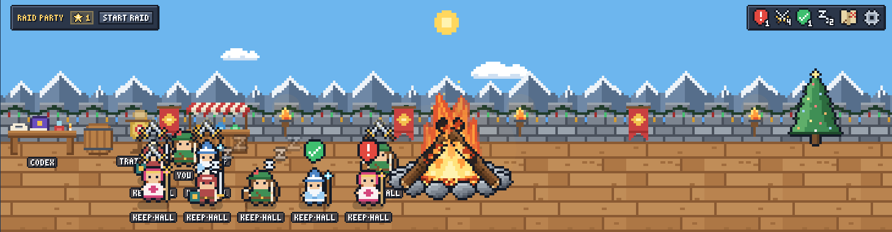

# Idle RPG

Turn your agents into a raid party. Collect loot and upgrades as you progress.

A castle rampart across the top of the window, in pixel art, staffed by a small adventuring party. You and every agent are stubby, dark-outlined characters in one of four classes (wizard, healer, warrior, archer), and what each agent's character is doing shows that agent's status. Behind the battlements the sky runs a full day and night every 20 minutes, with drifting clouds. Below it are the tabs and terminals; the standard Spaces and Agents sidebar is on the left.

*The day and night are sped up in this recording: a full cycle takes 20 minutes, not 18 seconds.*

## What you see

- **Sidebar (left, 268px):** Herdr's own sidebar, unchanged: brand bar, Spaces, Agents, footer.
- **Scene (top of the rest, one third of the height, 230 to 560px):** a pixel-art scene at 4 screen pixels per art pixel. Back to front: a sky of night blue `#0b1230` with a tiled star field, a day-blue layer `#6db6ee` and five orange `#f2924e` horizon bands, each faded in and out by the time of day; a sun and a moon riding one circle half a turn apart and setting behind the wall; four clouds drifting left to right at 6 to 12 px/s, dimmer at night; a tiled snowy mountain range; 64px grey stone battlements with red banners and torches whose glow flickers and brightens at night; a 152px floor of tiled wooden planks with a table (scroll, potion, candle) and a barrel at the left. At night a half-strength dark tint lies over the sky, and darkness (`#0a1030`) over the wall, the floor and everyone on it, under the cards: a row of pictures (`art/light/`) fading in with the night, `candle` (272px, the left end), a `torch` per torch (384px, flame in the middle) and `fill` (384px, never stretched: the app keeps a picture's proportions) for the rest; each keeps a pool of light round its flame, the dark deepening in six steps to half strength and thinning out over 80px above the wall. Between raids the campfire's wider, lower pool, `fire-<i>` (320px), is cut into the row over the fire, the pictures it overlaps clipped short (an `overflow_hidden` box each) so every pixel is darkened once; it carries the torches' light too (the lighter wins), one picture per 16px step along a torch's 384px (24, `i`), wholly dark at its edges (the generator asserts it), so it meets its neighbours without a seam. **The HUD** (`hudLayout`): three pixel frames 42px high from y 8, 8px apart, over the night's darkness and under the cards: the **sign** at the `inset`, the **stage section** centred while the fight shows (below), the **strip** 10px from the right. A frame (`framePieces`, 2 screen px an art px) is a fill `#2b3649`, a band along each side of outline `#141a26` and bevel (light `#56657e` top and left, dark `#1d2534` bottom and right), and the 3×3 corners of `art/frame/`, outer pixel cut. Their text is the **lettering** (below), in capitals. The **sign**: "RAID PARTY" in gold; "NOBODY IN YET" in grey with no agents; chips of an icon (7×7 art px plus outline, 18px) and a count (shortened from 1,000: "1.2K"): in battle mode, once anything is slain or earned, a skull with the kills (opens the codex) and a coin with the gold (the shop); once a class has a skill point, or there is gold or training, a star with the points left across all classes, gold on a faint gold square while there are any, else the chip at 55% (the skills panel). A chip (22px, 2px edge) is clear, lighter under the pointer, sunk (darker, outlined) while pressed or its panel open. Last the raid button (22px: a 2px outline, a lighter top and darker bottom edge; lighter under the pointer, darker pressed). Short of room the title goes, the stage section drops to a second row (y 54), then the strip; below 640px the strip is under the sign, and a sign too wide wraps into rows. A press on a frame's empty part closes panels and cards, no walking. Damage numbers, crits and level-ups lie over the frames. The **strip**: an icon per status with agents (red alert: need you; crossed swords: working; green tick: done; "Zz": resting) at 3 screen px a pixel (27px), its count on a badge at its bottom-right in the white pixel font ("99+" past 99) with a tooltip ("Resting: 2"); then, from 640px wide, a folded map (`icons/map`, 30px) on a chip 4px left of the gear, opening the stage picker; then the grey gear (30px) on a chip, opening the settings.
- **You (72×72):** one of the four classes, picked at random the first time and remembered, with the tag "YOU" (below).
- **Looks:** every character wears the colourway, weapon and hat its class has equipped in the shop (the defaults and no hat until others are bought and put on), wherever a class sprite is drawn: standing, walking, dangling, fighting, a card's portrait, the class picker, the skills panel's and the shop's tabs and previews. Body (without its weapon), weapon and hat are three pictures laid one over the next at the same size and place (`sprite()` in `main.js`, the one place that stacks them); no hat, no hat picture; the healer's weapon (the potion it throws; its staff is its body's) has a picture only in its wind-up. A card's portrait shows the sprite 6px lower while a hat is on, so its top is not cut off.
- **Agents (72×72):** one per agent, each a class picked at random when the agent first appears and remembered for that terminal. Each stands on a soft shadow with a status bubble by its head and its **name tag** under its feet (y +11): where it works, "SPACE·TAB" (a blank name and its dot left out; "·" alone if both are).
- **Name tags** (`tag` in `main.js`; agents', "YOU" under you, and the stations'): the lettering in white on a small plate, 18px high, the text plus 4px a side: a fill `#2b3649b8`, a 2px `#141a26` outline with its corners cut (a band with a top and bottom border and a 2px bar at each end), no bevel. At most 84px wide (`TAG_MAX_W`, so tags at the default 88px spacing keep 4px apart) and kept 2px inside the scene. Any text goes through `letterFit` (`rules.js`): lower case as capitals, accented letters folded (`normalize("NFKD")`, marks dropped: é to E), combining marks, joiners, variation selectors and skin tones dropped, a zero-width-joined emoji or a flag one character, anything else the box `UNKNOWN`, runs of white space one space; cut to 38 art px after the last character that leaves room for "…" (spaces before it dropped), reading no further. When the tag cannot show the name as typed, its tooltip has the whole of it ("space · tab"), as does the card. Under the pointer a station's tag, and yours while your card is open, is outlined in white on a solid `#2b3649`. Each tag is 5 elements and 2 a character.
- **Tab bar (42px) and terminals:** Herdr's `tabs` mod, then the active tab with each pane as a card (radius 10, 1px border, `pane` header 30px).
- **Theme `idle-rpg`:** dark navy terminals (`#101c2c` on `#dbe7f3`), accent `#5cc8ff`.

## How it behaves

- **working:** the character bounces, and two pixel swords over its head swing together and apart with a spark flashing as they meet (native `loop` on `left` and `opacity`, 520ms).
- **blocked:** a red pixel speech bubble with a white "!" that hops (native `loop` on `top`).
- **done:** a green pixel speech bubble with a white tick, still.
- **idle:** the character stands still while three pixel z's of growing size drift up beside its head and take turns fading (native loops, 2.4s).
- The focused agent's shadow, and the one whose card is open, has a pale yellow ring.
- **Click empty space:** you walk there (4ms per px, clamped to the floor), alternating two walk frames every 160ms: a one-pixel lean each way with the other foot tucked up.
- **Click an agent:** a card opens above it, or beside it without room: a 56px portrait (the sprite at 6px a pixel, cropped to the head), its full "space · tab" name as its title in the app's font, the kind of agent (program name), status and for how long, terminal title, a "Go to terminal" button (`agent.focus`) and a close button. Under the portrait, a 10px line for the agent's class: its name, "Lv n" in gold `#ffd166`, a 5px gold bar of the way to the next level, "into/need" experience, and with skill points to spend the gold star and their number; it highlights on hover, and a click opens the skills panel on that class and closes the card. A small wrench at the portrait's top right toggles a row of the four classes (the current ringed), each with its "Lv n"; picking one changes the sprite, saves it and hides the row. Clicking the agent again closes the card.
- **Click yourself:** a smaller card with your portrait, class name and the same wrench, and two level lines: "You" (your own level) above your class's.
- **Drag an agent:** after 4px of movement it becomes a dangling sprite that leans against the direction of travel. Releasing drops it; released over the wall, it falls to the floor.
- **Stations:** on the non-raid screen only (battle mode off) three things stand at the back of the floor, each opening one of the panels the sign's chips open during a raid, and closing it when clicked again: the **codex** is a purple book lying on the table (the whole table is the target); the **skills and training** are a straw training dummy with a target on its chest (48×72, left 204), labelled "Training" (points waiting are on the sign's star); the **shop** is a merchant's stall with a red and cream striped awning and goods on its counter (104×84, left 304). Each has its name tag ("CODEX", "TRAINING", "SHOP") centred 3px under it, and a press on one does not reach the floor. Under the pointer a station shows it can be used: its picture (`stations/<name>/idle`) swapped for its `hot` twin, the same picture inside a one-pixel white outline (4px on screen; for the codex, both the table and the book), hopping up 4px (120ms; for the codex only the book hops), a white arrow (`stations/arrow`, 28×20) bobbing 8px over it, its tag outlined in white, and a pointer cursor. It shows by day and night, in the scene's pixel style. They are props, drawn before the characters and dimmed with them at night, and are not drawn during a raid, when the formation needs the floor.
- **Campfire:** between raids only, in the middle of the floor: a ring of grey stones (lit from the top left, each in its own outline), four crossed logs with bark, pale sawn ends and charred tops, a bed of embers and tall flames in the torch's colours, deep orange out to a near-white core (216×180, 52×43 art px plus the outline's margin; feet at floor y 100). It is at the scene's middle to the nearest 16px, never left of x 528 (clear of the stall, and inside the right edge at 640px); not drawn below 640px. Scenery: no hover or cursor; a press on it walks you there, except that a press across it (within 116px of its middle) short of floor y 112 stops you just in front of the stones. A newcomer's default spot is never behind it (above floor y 100; the row at y 104 is used); an agent saved behind it (an older save, a drop, another width) is drawn on the same row just past its nearer side (the far one when that is off the scene) while it burns, the spot unchanged; you, saved in it, are brought out to y 112. It is drawn among the characters by depth (its y is its feet's). It flickers with native loops only: `campfire/base` (stones, logs and the low heart of the flames, never changing) under four taller flames (`campfire/flame-1` to `-4`) fading in and out on their own periods (520, 740, 380, 610ms), four one-pixel sparks drifting and fading over it, and behind it a warm glow like a torch's (216×144, `#ffb34750`, flickering, 25% by day, full at night). At night it lights a pool of its own (above).
- **Battle mode:** a button in the sign toggles it (red "Return to town" while it is on, grey "Start Raid" while it is off; saved; on by default). When on:
  - **Monster:** the boss of the stage being fought (below) stands in the middle of the floor, feet at floor y 108: a slime (136×104), an ogre (200×200) or a dragon (328×264). Its **name plate** (`plate`, 4px over its picture, kept in the scene and under any HUD frame its width spans when the wall is low) is a HUD frame 38px high: the name in gold (from x 8, y 6) and right-aligned 8px from the right `hp/maxHp` in white, shortened (`shortNumber`: "1.2K/3.4K", rounded up); under them (y 22) a bar 10px high, a 2px `#141a26` outline round a `#1d2534` well, its fill green `#4cd47b` above half, yellow `#ffd166` above a fifth, red `#ff5d5d` below, each with a 2px lighter top edge (`#9ff0bd`, `#ffe7a3`, `#ff9b9b`), width eased over 150ms; and while any applies a row of status icons (y 34, 18px, the plate 20px taller). Its width is fixed per kind: 8px a side, then at least 136, else the name, 8px and the widest HP ("9.9E99/9.9E99"): slime 168, ogre 156, dragon 174. The **stage section** (top centre, in a frame) is a fixed width, 30% of the scene's (`STAGE_SHARE`; at least its fullest line, at most 520px), whatever it shows; an arrow at each end (`icons/prev`, `icons/next`, 10×14, on chips; one dimmed to 30% and dead when it would leave 1 to the highest stage reached), "STAGE N" in gold after the left arrow, the attempt's minutes and seconds left before the right arrow (`clockText`: "9:42", seconds rounded up; white while it runs, grey while it stands still; none while the boss is down), and under them a 4px bar of the time left, `#5cc8ff` while it runs and `#5d7088` while it stands still, its width eased linearly over 250ms. Each boss is a still picture with pieces moving over or behind it on native `top` loops, so nothing shows through (`art/monsters/<kind>/`): the slime's dome (`top`) sinks 8px into its foot (`base`) and rises (1.7s); the dragon's tail (`tail`) sways 5px behind its `body` (2.6s); the ogre and dragon breathe, the upper body (`top`: head, shoulders and arms, or head, neck and wings) rising 3px, feet planted. Every 14s the ogre shows `roar/roar` for 1.1s. Every 19s the dragon roars instead of breathing (1.5s): rears back (`roar/rear`: head and neck drawn back and up, wing tips up 4px, 300ms), roars (`roar/roar`: head forward, jaws wide showing mouth, tongue and teeth, brow lowered, wing tips up 8px, 950ms) while its upper body (`roar/top`, cut where `top` is) shakes 2px each way (a `left` loop, 140ms), then settles (`roar/rear`, 250ms). Three rings of sound (`roar/wave`, 28×56) leave its mouth 180ms apart, each gliding 130px left over 800ms, fading in and out (drawn unseen at the mouth from the wind-up, to have something to glide). The tail sways throughout; no roar while it is down. All blink every 5.2s (an eyelid overlay for 170ms; never during a roar), and hop 4px when a blow lands.
  - **Stages** (`rules.js`): the fight is always against the boss of stage N, from 1. The kind cycles slime, ogre, dragon (`stageKind`). HP is `STAGE_HP × HP_GROWTH^(N-1) × N^HP_POWER` (900 × 1.175^(N-1), the power 0: 900, 3.8K at 10, 43K at 25, 2.4M at 50), a real number. Each attempt has `stageTime` (`STAGE_MS`, 10 minutes), 250ms off per attack-clock tick while anyone is in the fight (`clockRuns`: a working agent, up or knocked out) and the boss lives; "(PAUSED)" while nobody works. A kill in time clears the stage: the next is reached (`best`, the highest reached) and, with "Advance after a kill" on (the default), fought next; off, the kill repeats the stage. When the time runs out, the only loss, the attempt fails (`fail()` in `main.js`, `failStage` in `rules.js`): back to the stage before the highest reached (never further: a failure there or lower repeats it) with a fresh attempt, and the party is **farming** (`farming`, saved): kills repeat that stage whatever the setting, until a stage is picked; `best` is unchanged. At stage 1 the same boss is back at full HP and time. A red note in its own frame under the stage section, over the plate, pops in ("TIME'S UP! BACK TO STAGE 7" or "TIME'S UP!") and fades over 1.6s from the render a second later; only the attempt is lost, its blows' experience saved once. While farming, a green "FARM" follows the stage number and the next arrow pulses (a native `opacity` loop). The arrows (and the stage picker) pick any stage from 1 to `best` (`canSelectStage`, `selectStage`): a fresh attempt at its boss at once, saved, and the end of farming. The boss and the time left are never saved: loading starts a fresh attempt at the saved stage.
  - **Biomes** (`BIOMES`, `biomeOf`): a raid is in its stage's biome, ten stages each: forest, hills, caves, hell, then round again. It follows the boss fought; the town is always the rampart. Tiled at their own shapes (`biomeArt`): `far` for the mountains, `mid` for the wall, `ground` for the planks; no banners, torches, table or barrel. Forest and hills keep the sky, day and night (the darkness `fill` alone). Caves and hell have a `ceiling`, no sky or darkness, and at each torch's place a glowing `crystal` or `vent`. Each ground averages 4.5:1 or more against the outline.
  - **Formation:** every agent glides (700ms) from its own spot to a place computed from its class: warriors 44px outside the monster's bulk (the `half` width in its `core`, not the edge of its picture, so they stand under a dragon's head and tail) and just in front of it at floor y 114, everyone else 360px out from the picture's edge (five characters; less on a narrow scene), alternating left and right, each next one on a side 62px further out and staggered between floor y 96 and 60. Turning battle off glides them back. Agents cannot be dragged while in formation.
  - **Attacks:** each working agent attacks on its own rhythm, each attack in phases of 250ms (`TICK_STEP`): wind-up, two of strike or flight, impact, then rest; its damage comes off at its own impact, so the bar moves with each blow. From one attack's start to the next is set by the class's Haste, 12 ticks (3s) at rank 0 to 7 (1.75s) at rank 5 (`ATTACK_TICKS`), times its weapon's factor and the haste aura (`cadence` in `effects.js`, a real number of ticks). A newcomer first attacks anywhere in its first gap, and each gap is the mean give or take up to 2 ticks, evenly (`nextGap`), counted from when the last was due, so fractions carry. No gap is under 6 ticks (`MIN_ATTACK_TICKS`: the four phases, the rest and the impact's 350ms fade). Blows land around the middle of the monster's bulk (`core` in `MONSTERS`: an offset from its centre line and feet, and a radius), scattered by a hash of the attacker's address and its attack's start tick, so nothing flies through a big sprite's empty corners. In formation every sprite is a 96×72 fighting pose facing the monster (`classes/<class>/<look>/{stance,windup,strike}/{l,r}.png`): stance, wind-up on phase 1, strike on 2 and 3, with its weapon, whose attack pictures it uses (`attackArt`). Warrior: raises its weapon, swings it level at full reach, and a slash pops in at the tip and fades (white for the sword, a broad cleave for the axe, a crunch for the hammer, orange for the Fire Blade). Archer: draws with an arrow nocked, looses; the arrow flies to the monster in 500ms, then a spark (a crossbow is held level, with no string to draw, and shoots a short bolt; the Fire and Ice Bows' arrows land in an orange or icy spark). Wizard: raises its staff or wand, thrusts it out; a spell of its element flies, then a burst of it (fireball, ice shard, bolt of lightning, glob of venom). Healer (mirrored, free hand toward the monster): lobs its potion in an arc (up 44px, then down), then a splash in its colour. Projectiles are hidden at the hand, shown only in flight, and slip back unseen. A working agent in formation shows no swords overhead and does not bounce.
  - **You:** when at least one agent is working you attack too, on your own rhythm and with your class's skills, with the same poses and effects, facing the monster from wherever you stand. As a warrior you only attack (and only count) within 90px of the monster's bulk. While walking you use the walk frames and do not attack: you join in once you arrive.
  - **Weapon effects** (`effects.js`, plain functions; every number a constant there). A weapon multiplies its blows' damage and its gap by one factor (`WEAPON_FACTORS`), so damage per second is the class default's: War Axe ×1.5, Hammer and Crossbow ×2, Ice Wand and Toxic Rod ×0.75, the rest ×1; a gap held at `MIN_ATTACK_TICKS` raises the damage to match. Each boss kind is weak to one element (×1.5) and resists one (×0.75): slime frost / poison, ogre fire / storm, dragon frost / fire (`WEAKNESS`). Each element leaves a status (`strike`, `tickStatuses`): fire Burn, 20% of the blow over 3s, per class, a new hit adding to what is left and restarting it; frost Chill, everyone's crit chance +10% on the 16 ticks (4s) after the hit's; storm Chain, 20% chance the blow strikes twice; poison Venom, 20% of the blow over 6s, at most 5 stacks. A healer on the Haste, Might or Hex Vial gives an aura while it stands (`partyAuras` of the attackers): every gap 15% shorter (the floor holding), +30% damage, the boss taking +15% from everything; it deals half damage; one aura per vial however many carry it. What an aura adds is owed to the healer class (`shares`): Hex's added share of every blow and tick, then Might's, then of a hasted blow the share Haste adds; the attacker gets the rest, so a kill's experience is unchanged. Statuses live in memory with the boss, cleared by a new boss, a failed attempt, a kill and the raid's end, ticking while the time runs (all knocked out too); burn and venom are gathered (`dots`) and land once a second as the seconds shown turn (or every 4 ticks), one blow per class and status, credited to that class (its level-up note over one of its characters, else you). Drawn on the boss around its core, 2 to 4 (slime, ogre, dragon) of `effects/burn/flame-1`/`-2` crossfading, `effects/chill/crystal` with a twinkling `glint`, a pair of `effects/venom/drip-1`/`-2` a stack (native `opacity` loops); a chained blow's `effects/chain/arc/{l,r}` (56×28) pops past the first burst, its second number at its end; the plate's icons (`plateIcons`: `effects/icons/burn`, `chill`, `venom` with its stacks in the white pixel font, `hex`), 18px; an aura healer's vial icon (`haste`, `might`, `hex`) by its HP bar, in its vitals box.
  - **The boss fights back** (`party.js`, run from the attack clock's tick, no timer of its own; HP in memory only). In the fight: the working agents and you (`fighters()`), knocked out or not; one that leaves comes back within the attempt as it left (`away`: its HP, its rest frozen). Max HP is `maxHpOf`: `CLASS_HP` (wizard 100, healer 100, warrior 200, archer 130) × the level bonus × `HEALTH_BONUS`^Health (1.12). The boss attacks every 16 ticks ± 2 (the first within its first gap): one to three single blows at a random attacker, then an area attack. A blow is `stageDamage(N)` (4 × 1.175^(N-1) × N^0.5) for a party of four, × (n/4)^`SCALE_POWER` (1) for n standing. Single: a pose (`attack/spit/{l,r}`, `swing/{l,r}`, `bite`, in place of its pictures, leaning 10px to the target) for 2 ticks while a glob or gust flies (from the next render), then a splat, thud or claw marks on the target. Area: `foe/marker` (148×76, pulsing) round the target's spot for 4 ticks under the pose (`squash`, `slam`, `breath`), a glob or fireball flying there, then everyone standing in the ellipse (70px each side, 35 up and down) is hit (a crowd: as many as stand in it in the old formation, those nearest the drawn spot: `caught`), the spot covered (`puddle`, `quake`, `blaze-1`/`-2` flickering). Each hit flashes `foe/hit` on its target. Over each fighter a 40×5 HP bar (green, yellow, red). At 0 HP a character is knocked out for 120 ticks (30s, `KO_TICKS`): no attacks, lying (`down/l` with the monster to its right, else `down/r`), `status/dizzy-1`/`-2` crossfading over it, a gold bar running down natively from the render after it fell, and right of it (x +23, y −82) the seconds left in the gold pixel font at 2px (`restSeconds` as of `koBeat`: all turn together on the stage section's seconds, or every 4 ticks while the time stands still, so any number cost at most a render a second; 30 as it falls); never the "Zz". Everyone is up at full HP for each new attempt. No wipe: with everyone down the boss waits (next attack kept 4 ticks off); the time runs on. Every healer heals on a rhythm (`healTicks`: 24 ticks ± 2, 12 on the Heal Vial; no Haste or aura): to the standing fighter lowest for its max under full (`healTarget`; none, no throw), the healer's max HP (`healOf`), in the Heal Vial's potion and splash, `status/heal` and `sparkle` rising; re-picked at impact. A working healer also attacks with its vial: one pose, the heal first, each waiting for the other to end. An idle, done or blocked healer (`standby()`) throws from its formation spot while anyone fights: never hit, no aura or HP bar, not counted for gold, experience or the clock. A heal earns what a healer's blow would (`blowXp`, the fighters as attackers) times the share needed. Renders: as an attack starts, a tick later, as it lands and two ticks after. You cannot walk while knocked out.
  - **Defeat:** at 0 HP the boss fades out over 1.6s, the plate reads "SLIME SLAIN!" over the empty bar (the stage section already on the next stage), the sign's count of the slain goes up, gold is paid (below), and 3 seconds later (`RESPAWN_MS`, seen by the 1s watch) the boss of the stage now being fought appears. After the kill that first clears a stage and moves on (it raised `best`; not farming, advance off or replaying) the wait is 5s (`ADVANCE_MS`) and "MOVING TO STAGE N IN 3" (gold, in the "Time's up!" note's place) counts it down, drawn by the watch once a second; picking a stage cancels it.
  - **Progress** (`rules.js`): progress never belongs to an agent, which is short-lived; it belongs to you and to the four classes. All of it is booked in `fight()`, per blow that actually lands: none while battle mode is off or the scene is too narrow, none on a boss already at 0 HP, and when the blows on one tick hold more damage than the boss has HP left, only what it had counts (blows in attacker order).
    - **Damage** (`damageOf`): a blow by a character of a class deals `BASE_DAMAGE` (10) × its level bonus (`1 + LEVEL_BONUS × (level - 1)`, 0.12 a level) × its training bonus (`TRAINING_BONUS^level`, 1.12) × its Power (`1 + POWER_BONUS × rank`, 0.2), all the class's, so every character on it, you included, hits the same; a real number, shown rounded and shortened (`shortNumber`: "1.2K", then M, B, T; "12000T" past that).
    - **Experience** (`blowXp`, `credit`): a blow earns its share of the boss's HP of what a whole kill at its stage is worth, `stageXp(N, attackers)` = `ATTACKER_XP × attackers × XP_GROWTH^(N-1)` (200 × attackers × 1.03^(N-1), attackers counted as for gold), to the class of whoever dealt it, and the same to you (`PLAYER_XP_SHARE`, 1): levels keep pace with stages, not damage. Experience is a real number; levels count whole points.
    - **Levels:** everyone starts at level 1 with 0 XP, with no cap. Going from level n to n + 1 costs `CLASS_LEVEL_XP * n` (100n) for a class and `PLAYER_LEVEL_XP * n` (250n) for you, so reaching level L takes `step * (L - 1) * L / 2` in all. Only total experience is stored; `levelOf` derives `{ level, into, need }` from it.
    - **Gold:** on a kill only, `stageGold(N, attackers)` = `floor(ATTACKER_GOLD × attackers × GOLD_GROWTH^(N-1))` (0.5 × attackers × 1.23^(N-1)), at least 1, growing a little faster than HP (farming far below the limit pays less); the attackers are everyone in the fight on the tick the boss fell (the working agents, knocked out or not, and you when you join in), at least 1 and at most `MAX_GOLD_ATTACKERS` (20). Three agents and you get 2 at stage 1, 12 at 10, 287 at 25, 51K at 50.
    - **Training** (`TRAINING`, `train`): gold buys a class levels of Attack, one at a time, at `floor(TRAINING_PRICE × TRAINING_PRICE_GROWTH^level)` (5 × 1.45^level: 5, 7, 10, 15, 22 … 205 for the 11th), each multiplying its damage by 1.12, and of Health on the same curve (its own level), each multiplying its max HP by 1.12. Stored per class as `{ attack, health }`. `canTrain` is false while the gold is short.
    - **Kills:** the total `slain` plus a count per kind (`slime`, `ogre`, `dragon`). On old state the counts start at zero. Shown in the **codex**: a dark panel (176px wide) under the sign, drawn last so it lies over the floor, opened and closed by the skull count on the sign and closed by its × or a click on the floor. One line per kind: its picture scaled to fit 24px, its name and its count; a kind never slain is dimmed to 25% and named "???". When the total is higher than the counts add up to, a last line "Before the codex" holds the difference.
    - **Skill points** (`rules.js`): each class earns `POINTS_PER_LEVEL` (1) skill point per level past 1, so a class at level L has earned L - 1, and spends them on that class's skills only. Every class has the same three skills (`CLASS_SKILLS` keeps a list per class, so one can get its own later), each from rank 0 to `MAX_RANK` (5) at `RANK_COST` (1) point a rank. A class's ranks apply to every character with that class on, agents and you alike. **Power:** each rank adds `POWER_BONUS` (20%) to the class's damage (see Damage). **Haste:** each rank takes one tick (250ms) off the time between attacks (see Attacks: 3s down to 1.75s). **Crit:** each rank adds `CRIT_CHANCE` (5%) chance that a blow is critical and deals `CRIT_MULTIPLIER` (2) times its damage; the roll is `r < chance` for a random `r` from 0 to 1 (`blow` in `rules.js` takes `r`). Points left are never stored (earned minus spent). A free Reset per class gives all its points back. Your own level unlocks nothing yet.
    - **Skills panel:** a dark panel like the codex (232px, under the sign at y 54, drawn last, closed by its × or a click on the floor, stopping clicks), opened from the sign's star (on the first class with points, else yours; the star again closes it) or a card's class line (on that class). One of the codex, skills panel, shop and a card is open at a time. Rows have fixed heights and text a 13px line (`PANEL` in `main.js`), so the height is known. Top to bottom, 3px apart inside 6px of padding and a 1px border: a 16px title (a star, "Skills & Training", the gold shortened, "1.2M gold", in gold, the ×); a 24px row of the four classes, each its sprite at 18px beside "Lv n" and, in gold, "+n" points, the chosen ringed in `#5cc8ff`, one with points edged in faint gold, a click choosing it; 15px rows: "<Class>: n points to spend" (gold) or "no points to spend" (grey) with a small "Reset", dimmed and dead when nothing is spent; a line per skill: name, "rank/5" in gold, what it gives in grey ("23 damage (+40%)": a blow's damage, "attacks every 2.5s", "10% crit"), and a small `#5cc8ff` "+", dimmed and dead with no points or at rank 5; a line per training: name ("Attack", "Health"), "Lv n" in gold, its factor in grey ("x1.12 damage", "x1.12 HP"), and "Buy <price>" (shortened), dimmed and dead while the gold is short. Spending, resetting or buying saves at once. Height 129 + 18 a training: 165px, ending at 219 in the lowest scene (230px).
    - **Shop** (`rules.js`): gold buys looks for a class, never for an agent (agents are short-lived and forgotten after a week): every character with that class on, agents and you alike, wears what the class has equipped. Colourways, weapons and hats for now. `SHOP` holds one entry per kind of item, in the order the shop lists them: `armour` ("Armours": the colourways, which recolour the whole outfit), `weapon` ("Weapons") and `hat` ("Hats"), each with a catalogue per class of `{ id, name, price }`. Every kind is equipped per class the same way, and a new kind is one more entry. Armours and weapons are owned per class (ids repeat across classes: buying the warrior's `flame` does not give the archer its `flame`). Weapons: each class's default (id `default`, free, always owned: what it always held) and three more at `WEAPON_PRICES` (15, 30 and 50 gold, in catalogue order); each also carries `element` (`ELEMENTS`, or `null`) and the healer's a `potion` (`POTIONS`), which `effects.js` reads. Warrior: Sword (default), War Axe (`axe`), Hammer (`hammer`), Fire Blade (`flame`, fire). Wizard: Fire Staff (default, fire), Ice Wand (`frost`, frost), Bolt Staff (`storm`, storm), Toxic Rod (`venom`, poison). Archer: Longbow (default), Crossbow (`crossbow`), Fire Bow (`flame`, fire), Ice Bow (`frost`, frost). Healer: Heal Vial (default, potion heal), Haste Vial (`haste`), Might Vial (`might`), Hex Vial (`hex`). Hats are not tied to a class (`shared: "hats"` on the kind): every class has the same catalogue, and a hat bought once is owned by all four, kept once in the state's `hats`, while each class still has its own on, so classes can wear different hats or the same one. Hats: "No hat" (id `default`, free, always owned: the class's own headgear), Party Hat (`party`), Santa Hat (`santa`) and Pumpkin (`pumpkin`) at `HAT_PRICES` (10, 20 and 30 gold). Every class has four colourways, its default (free, always owned) and three at `COLOUR_PRICES` (5, 10 and 20 gold): wizard Violet, Crimson, Moss, Frost; healer Teal, Rose, Sky, Plum; warrior Steel, Cobalt, Jade, Ruby; archer Forest, Scarlet, Azure, Dusk. `canBuy` is true only for an item for sale, not yet owned (a hat, by any class), with the gold there; `buy` takes the price off the gold and adds the item to what the class owns (a hat, to `hats`, for every class), for good (no refunds, no selling), and does nothing when it cannot, so gold never goes below 0. `equip` puts on an owned item, free, as often as you like.
    - **Shop panel:** like the skills panel but 318px wide (under the sign at y 54, drawn last, closed by its ×, the gold chip again or a click on the floor, stopping clicks), opened from the gold chip on your class, fixed rows (`PANEL`, `SHOP_ROW`; 167px, ending at 221 in the lowest scene). Top (16px): the coin, "Shop", your gold, the ×. Left, 78px: the kinds, 22px each, icon and name ("Armours", "Weapons", "Hats"), the chosen ringed in `#5cc8ff`, "More soon" in grey under them; it opens on Armours. Right, top to bottom: the four classes in a 24px row, each its sprite at 18px in what it has on, the chosen ringed, 80px wide and named, the others sharing the rest, named in a tooltip; then the chosen kind's items for the chosen class in tiles 78px tall (about 51px wide): a preview of the class in what it has on but that item, standing (36px) for Armours and Hats, winding up (`windup/r`, 48×36, where every weapon and potion shows) for Weapons; its name; and "Equipped" (`#5cc8ff`, the tile ringed), a small "Equip" button (owned) or "Buy n" (not owned), dimmed and dead while the gold is short. A hat bought on one class shows "Equip" on the others. Buying also puts it on; both save at once. On Hats the line under the kinds reads "Bought once, for every class" in gold. Clicking a tile picks it (ringed faintly; the one on until then), and two 13px lines under the tiles say what it is (`shopLines`, each within the 210px column at size 10 in Geist, tested for all 16): name and pace ("Hammer: 2× damage, half speed"), or at normal speed its status or aura ("Fire Bow: Burn: +20% in 3s"), then the rest ("Normal speed · Weak: ogre · Resist: dragon"); a look's "Looks only". The gold chip shows only in battle mode; between raids the shop opens from its station. Starting or ending a raid closes any panel.
    - **Damage numbers** (the "Show damage numbers" setting, on by default): each blow that lands puts up what it dealt (a killing blow only the HP that was left), shortened ("1.2K"), in the pixel font, centred 8px over where it struck, nudged 12px left, right or not at all by a running count so blows landing together do not cover each other. A plain blow is white at 3 screen px a pixel; a critical one gold at 4 with a "!" ("8!"); burn and venom (summed over a second) `ember` and `venom` beside the boss's middle, left and right. A blow on the boss's weakness has `effects/marks/weak` (an orange ▲) after it, one it resists `marks/resist` (a grey ▼), glyph-high, sharing the last outline column. Never less than "1". It pops in and stays while the attack clock is on its tick (`fresh(tick)`: by ticks, not elapsed time, so a late first render never shows it faded); the first render after (the next tick renders during the rest) makes it rise 36px (`DAMAGE_RISE`) and fade over 0.8s (`DAMAGE_MS`), native transitions, no timer. At most 12 (`MAX_DAMAGE`), the oldest dropped first; over the night's darkness, under the cards; dropped once faded, and all at once with a new boss, battle mode off, a narrow scene, the setting off, and as the layout closes. A number that popped in on the last tick makes the tick render (burn and venom can land with nobody mid-attack).
    - **Critical blow** with damage numbers off: a small gold number, the blow's damage and "!" ("6!") on a dark pill, pops in where the blow landed, then on the first render after its tick rises 18px and fades over 1.2s (`CRIT_MS`), like a level-up note. With them on, the gold damage number takes its place.
    - **Level-up:** a gold note ("Wizard 3!", "Level 4!") on a dark pill pops in over the head of whoever landed the blow (yours over you, whoever's blow it was), then on the first render after its tick rises 18px and fades over 2.4s (`CHEER_MS`) with native `top` and `opacity` transitions. Two level-ups from one blow share a note. Notes are dropped a second after they fade, follow a character gliding into formation, stay inside the scene when the wall is low, and are not shown over you while you walk.
    - These constants are defaults chosen to be retuned; nothing else depends on their values.
  - **Settings menu:** a dark panel like the codex (200px, 10px in from the right, 4px under the strip, drawn last, closed by its ×, the gear again or a click on the floor, stopping clicks). Opening it closes the codex, skills, shop and any card; opening any of those, or starting or ending a raid, closes it. Top: a small gear, "Settings", the ×. Then a line per `SETTINGS` entry (`rules.js`: `{ key, name, default }`): its name and a pixel switch, a square 30×16 track with a 2px `#141a26` outline, green `#4cd47b` on and slate `#3a4658` off, and a square 12px knob, cream on the right when on, pale blue-grey on the left when off, sliding in 120ms. A click on the line flips the setting and saves at once. Two settings: "Show damage numbers" and "Advance after a kill"; a new one is an entry in `SETTINGS` read as `this.settings.<key>`.
  - **Stage picker** (the map, in town or a raid): a HUD frame 4px under the strip, one panel at a time; the floor, a frame, starting or ending the raid, or a scene under 640px close it. It follows the stage while open. Top: "MAP" and the page ("STAGES 41-80", a round of the biomes) between arrows. Left, a chip per biome reached: swatch, name (gold where the fight is), stages. Right, the open one's ten stages: the one fought gold, those `canSelectStage` allows white, the rest grey and dead. A pick does what the arrows do (`toStage`; in town it sets the next raid's stage) and closes it.
  - The monster is hidden and everyone stays at their own spots when the scene is narrower than 640px. Nothing is fought then: no damage, experience or gold.
- Whoever stands lower on the floor is drawn in front. A small party's spots are remembered across restarts: a newcomer takes the first default spot (x 250 + 88k, rows y 64 and 104, none behind the campfire) clear of everyone (50px across, 30 deep).
- **Crowds** (`place`, `formation`, `townLattice`, `raidCrowd`, `crowdMarks`; linear in the agents): past the default spots, or a raid party over 12 that overlaps in formation, everyone stands on a brick lattice: rows 30px apart, every other shifted half a step, at the widest step that fits all (88px down to 50, then overlapping to 16, then shared). Nothing new is saved; a dropped agent's spot is kept. Town seats stay put in memory while the lattice holds; the stations and the campfire stay clear. Raid: warriors nearest the boss, the ranged spread over the rest of each side. Tags are drawn over everyone, never over another or yours, those needing you first; under 88px apart the rest show none, bubbles and HP bars likewise.

## Built from

- `layouts/idle-rpg.json`: root `row` (`titlebar: none`, theme `idle-rpg`) of `sidebar` (copied from Herdr's `main` layout: `workspace-chrome`, `spaces`, `agents`) and `office`, a `column` of `scene` (block, `idle-rpg` mod, props `{ inset: 16 }`, weight 1) and `work` (weight 2: `tabs` block, then the `tab: active` block with the `pane` header mod).
- `mods/idle-rpg/rules.js`: the game rules as plain functions with no host calls (stages, boss HP, gold and experience by stage, damage, training, experience, levels, skill points and ranks, what each rank gives, the attack gaps, the crit roll given a random number, kill counts, `shortNumber`, the shop's catalogue, buying and equipping, the name a class's pictures go by in a colourway and a weapon's and a hat's overlay pictures for a class, the pictures of each weapon's attack and each monster's, max HP, Health, the boss's damage by stage and the heal, the lettering's characters and `letterFit`, loading saved state) and their constants; `main.js` imports it as `./rules.js`, which a Herdr mod folder allows.
- `mods/idle-rpg/effects.js`: what weapons do, as plain functions importing only `rules.js`: each weapon's factor, the weakness table, `cadence` and `nextGap`, `strike` (a blow with its weapon, the boss's kind and statuses and the party's auras, given a random source) and `tickStatuses`, `partyAuras`, the shop's `statLines`, the plate's `plateIcons`, and the builders of its pictures' paths (`effectIconArt`, `markArt`, `overlayArt`).
- `mods/idle-rpg/party.js`: the party in a fight as plain data and functions (joining and leaving, the boss's next attack and where it lands, hits, knockouts and rests, the healers' rhythm and choice), imported by `main.js`.
- `mods/idle-rpg/main.js`: one `View`. Props: `inset`, the sign's left edge in px (default 84 leaves room for macOS window buttons when the scene is in the top-left corner).
- `herdr` functions: `agents`, `spaces`, `shared` / `setShared` (key `idle-rpg.state`, read back from the layout's older keys `raid-party.state`, `rpg.state` and `snow-loft.state` if missing), `props`, `run("agent.focus")`.
- **Saved state** (version 7): `{ version, you: {x, y}, spots: { <address>: {x, y} }, sprites: { you | <address>: <class> }, seen: { <address>: ms }, battle, stage, best, farming, slain, gold, kills: { slime, ogre, dragon }, xp: { you, wizard, healer, warrior, archer }, skills: { <class>: { power, haste, crit } }, training: { <class>: { attack, health } }, looks: { <class>: { armour | weapon: { owned: [<id>], equipped: <id> }, hat: { equipped: <id> } } }, hats: [<id>], settings: { damageNumbers, advance } }` (armours saved as `colour` are read as `armour`; `hats` is what every class owns, a class's `hat` only the one it has on). The boss is not saved (an older save's `monster` is ignored). `loadState` rebuilds the state from whatever was read and never throws; what older versions lacked starts at its default, the rest kept: before version 1, no gold, kills or experience; 1, every rank 0; 1–2, only the default colourway; 1–3, no hats, settings at default; 1–4, only the default weapon whatever `weapon` says; 1–5, stage 1 (`stage`, `best` 1), not farming, no training, "Advance after a kill" on. Validation: `settings` keeps only `SETTINGS` keys, a non-boolean getting its default; `owned` and `hats` keep only catalogue ids, once each, in catalogue order (`owned` always with `default`, `hats` never), an `equipped` id not owned becomes `default`; only a map's own keys are read (`__proto__` reaches nothing); a rank not a whole number 0–5 becomes 0, and a class whose ranks cost more than its level earned gets them all reset; `best` a whole number 1 to `MAX_STAGE` (1000; else 1), `stage` 1 to `best` (else `best`), `farming` true only if `true`; training a whole number from 0, capped at `MAX_TRAINING` (1000); experience a finite number from 0 (fractions kept); other counts whole from 0, capped at `Number.MAX_SAFE_INTEGER`; a field of the wrong type gets its default; spots without finite `x`/`y`, unknown classes and unknown keys in `kills`, `xp`, `training` are dropped. State with a higher `version` is read but never written (`save()` does nothing), so an older copy cannot erase a newer one's progress (it lasts until the layout closes). The first state key holding an object is loaded.
- gpui-kit: absolute positioning, `on_mouse_down` / `on_mouse_move` / `on_mouse_up` / `on_hover` on the root, `transition("left" | "top")` for walking and falling, `loop` and `frames` for the status animations, `transition("top" | "opacity")` for the damage numbers and level-up notes to rise and fade (they change on the render after they appear: a transition animates later changes, not an element's first appearance), `tooltip` on the status icons, `cx.timer.after` to end the walk bob and to chain the attack clock's ticks.
- `mods/idle-rpg/art/`: every picture, as PNGs, in folders by what they show and then by what it is doing, with short names inside (`tools/idle-rpg-sprites.py` writes the whole tree; 1,163 files in all). `main.js` passes `src("<folder>/<name>.png")` to `image()`; the paths that depend on the state or an agent are built only by `lookArt`, `weaponArt`, `hatArt`, `attackArt`, `monsterArt`, `biomeArt`, `glyphArt` and `letterArt` in `rules.js` and `effectIconArt`, `markArt` and `overlayArt` in `effects.js`, which return a known path (or the default, or null) for anything they do not know, so no saved string ends up in a path.
  - `scene/`: `wall`, `floor`, `mountains`, `stars`, `sun`, `moon`, `cloud-a`, `cloud-b`, `banner`, `torch`, `barrel`; and per biome `scene/<biome>/` (`BIOME_ART`): `far`, `mid`, `ground`, `swatch`, and in the caves and hell `ceiling` and `crystal` or `vent`.
  - `stations/`: `book`, `stall`, `dummy` and `table` (the table is always there; the codex outlines it and the book on it), each a folder holding `idle` and its white-outlined `hot` twin; and `arrow`, which bobs over the station under the pointer.
  - `campfire/`: `base` and the flames `flame-1` to `flame-4`.
  - `light/`: the night's darkness, `torch`, `candle`, `fill` and `fire-0` to `fire-23` (the only pictures with see-through pixels).
  - `status/`: what floats over an agent's head: `sword-l`, `sword-r` and `spark` (working; a plain arrow's or a bolt's impact is the same `spark`), `alert` (blocked), `done`, `z-1` to `z-3` (resting), `dizzy-1`, `dizzy-2` (knocked out), `heal` and `sparkle` (healed); `sword-l` is also the shop's weapons icon.
  - `effects/`: `icons/` (7×7 plus the outline: `burn`, `chill`, `venom`, `hex`, `haste`, `might`), `marks/` (`weak`, `resist`, 5×5 plus the outline), and on the boss `burn/flame-1`, `-2`, `chill/crystal`, `glint`, `chain/arc/{l,r}`, `venom/drip-1`, `-2`.
  - `foe/`: `marker` (where an area attack will land) and `hit` (on whoever a blow reaches).
  - `icons/`: the sign's, the corner's and the shop's icons, `swords`, `sleep`, `skull`, `coin`, `armour`, `hat`, `star` (a gold five-pointed star, for skill points) `gear` (a grey eight-notched cog, for the settings) and `map` (a folded map with a red cross, the stage picker), the card's `wrench`, and the stage section's gold arrows `prev` and `next` (3×5 triangles).
  - `attacks/`: by what flies or lands, then the weapon's variant of it (`attackArt` in `rules.js` picks them per class and weapon; every variant of one is the size of the first): `slash/<variant>/` (`default`, `heavy`, `smash`, `flame`), `arrow/<variant>/` (`default`, `bolt`, `fire`, `frost`) and `spell/<element>/` (`fire`, the fireball, `frost`, `storm`, `poison`), each with `l` and `r`; `burst/<element>` (the same four), `potion/<potion>` and `splash/<potion>` (`heal`, `haste`, `might`, `hex`), and `spark/<element>` (`fire`, `frost`, where those arrows land). The defaults are what each class always threw.
  - `monsters/<kind>/`: `idle` (the whole picture, also the codex's), `blink`, the pieces that move (`top`, and the slime's `base` or the dragon's `body` and `tail`), for the ogre and the dragon a `roar/` folder (the ogre's `roar`; the dragon's `rear`, `roar`, `top`, `wave`), and `attack/`, its two attacks (above). `MONSTER_ART` in `rules.js` lists them, `MONSTER_ATTACKS` and `attackPart` name each attack's pose, shot and hit.
  - `font/<colour>/`: the pixel font, the digits, `plus`, `bang`, `point` and `k`, `m`, `b`, `t`, `e` (the capitals `shortNumber` writes; from 1,000T up a number is a power of ten, "1.2E18"), each 3×5 art pixels (the point 1×5) inside a one-pixel dark `#141a26` outline that goes round the corners too, in `white`, `gold` `#ffd166`, `ember` `#ff9d3c` (burn) and `venom` `#a8eb6a`. `GLYPHS`, `GLYPH_COLOURS`, `glyphArt` and `glyphWidth` in `rules.js` name and measure them, and `pixelText` in `main.js` sets a string of them in a row, each its width plus 1 art pixel after the last so neighbours share an outline column. CI checks every character `shortNumber` can write is in `GLYPHS`.
  - `lettering/<colour>/`: the HUD's, the plate's and the tags' face (the font's 3-wide M reads as H in words): 5 rows, the font's digits, `plus`, `point`, `a`–`z` (M, W 5 wide, N 4, else 3), `bang`, `colon`, `quote`, `slash`, `dash`, `open`, `close`, and for names `under`, `comma`, `semi`, `query`, `and`, `hash`, `at`, `star`, `equals`, `less`, `more`, `lsquare`, `rsquare`, `percent`, `tilde`, `bar`, `backslash`, `dquote`, `dot` (·), `ellipsis` and `unknown` (a 4×4 hollow box); a drop shadow down-right instead of an outline; in `white`, `gold`, `grey` `#8ea3bb`, `red` `#ff7b7b`, `green` `#9ff0bd`. Named and measured by `LETTERS`, `LETTER_COLOURS`, `letterArt` (null for a space) and `letterWidth` (a space 1) in `rules.js`, set by `letterText` (through `letterFit`, so nothing is left out); the words are `LABELS` in `rules.js`, and CI checks every label, the bosses' names, `shortNumber` and `clockText` letter whole and that `letterFit` gives only `LETTERS`.
  - `frame/`: the HUD frames' (and plate's) corners `tl`, `tr`, `bl`, `br`.
  - `classes/<class>/<look>/`: fourteen pictures (`FRAMES` in `rules.js`): `stand`, `walk/{l,r}`, `rag/{c,l,r}` (dangling: straight and sheared a few pixels each way), the fighting poses `stance/`, `windup/`, `strike/` `{l,r}`, and `down/{l,r}` (knocked out: the standing picture turned a quarter turn onto the canvas's floor, head left or right). `<look>` is `default` or a colourway's id (`lookArt`). The body is drawn without its weapon, hands and all (the healer keeps its staff). A colourway swaps palette entries (`LOOKS` in the generator: clothing, armour, hair, trim; never skin, eyes or outline) over the same grids.
  - `weapons/<class>/<weapon>/`: each weapon's layer, its class's fourteen pictures (the healer's only `windup/{l,r}`, its potion held up; `WEAPON_FRAMES`, `weaponArt`), see-through, the size of the picture under it, over the body and under the hat. Drawn in rows of its own for the everyday 16×16 grid (also its stance), the wind-up and the strike (`WEAPONS` in the generator), held in the pose's hand and pushed through the body's canvas, lean, shear and mirror; outlined only where the body's outline does not go, so the default weapon over the default body is the pre-split picture pixel for pixel. A weapon keeps its colours whatever the armour.
  - `hats/<hat>/<class>/`: a class's fourteen pictures (`hatArt`), see-through overlays the size of the picture under them. Drawn per class (`HATS` in the generator: a few rows in the 16×16 grid, as every head sits differently and three classes wear headgear the hat covers or sits on: it hides the wizard's hat; the party and Santa hats leave the face showing; the jack-o'-lantern is a helmet with a carved face), pushed through the class's canvas, lean, shear and mirror (mirrored with the healer's poses), and outlined only where the body (not a weapon) under it is see-through, never across a face. One overlay serves every colourway and weapon.
  - The ids in `LOOKS`, `WEAPONS`, `HATS` and `SHOP` (`rules.js`) must match (order matters only in `rules.js`, for prices). CI checks every picture the rules and `main.js`'s quoted paths can ask for exists, and that `art/` holds exactly the generator's files, by path.
  - Class sprites are stubby 16×16 pixel art (big head, short body), a one-pixel dark outline, on an 18×18 canvas: PNGs at 8 image px a sprite px (144px) drawn at 72px, so each sprite px is 4×4 on screen and 1:1 on retina; dangling frames 22×22 (176px) at 88px. PNG, not SVG (which rendered soft); positions rounded to whole pixels.
- **Sky clock:** `cx.timer.every(10000)` in `init` stores `Date.now()` and re-renders; the time of day is `now % 20min`, so every window agrees. Opacities and the sun, moon and clouds glide between ticks (10s, linear). A cloud that wraps gets a new element id, so it does not glide back.
- **Battle clock:** a watch, `cx.timer.every(1000)` in `init`, brings the party in line with who is fighting (`muster`, no render), brings in a monster when due, and starts the attack clock if the time runs (`clockRuns()`: anyone in `fighters()`, the working agents and you if you can reach, the monster alive; nobody while battle mode is off or under 640px) or anyone rests; the toggle starts it too. The attack clock is one chain of `cx.timer.after(250)` calls (a flag keeps it to one chain) counting ticks (`clock`); it stops on the first tick when the time does not run and nobody rests (healers standing by never keep it going), and the watch restarts it within a second. Each rhythm (attackers, healers standing by) is in memory only: `{ start, next, mend, heal, seed }`, the tick its action under way started (null between), when its next attack and heal are due, whom a heal is for (null for an attack), and its latest start, which seeds where the blow lands. Each tick: whoever no longer acts loses their rhythm, a newcomer gets one, a due heal then a due attack starts, the boss's statuses tick (while the time runs), those on their impact phase strike (`strike` in `effects.js`: one blow, two if it chains) and land with `fight(blows)`, with a second's burn and venom when the seconds shown turn; then, the boss alive, 250ms comes off the attempt, failing it at 0. A phase is the clock minus the attacker's start, so staggering costs no renders; a tick renders only if someone is mid-attack (or resting after one), an attacker was cut off, a blow changed something, the seconds shown (stage section or countdowns) changed, the attempt failed, or the "Time's up!" note starts fading, so the time alone costs at most a render a second. Blinks and the ogre's roar are two `cx.timer.every` timers flipping a flag; the dragon's roar a third, chaining a `cx.timer.after` per step only while a living dragon is fought. Motion inside a phase is native transitions (`left`/`top`, `opacity`: 20ms in, 350ms out). The boss (`{ kind, hp, maxHp, stage, id, slainAt? }`) and the time left are in memory; the toggle, stage, kills, gold, experience, ranks and training in the shared state, saved on a kill and a failed attempt, never on a hit or spawn (a shared value re-renders every mod in the window), and once more by `close()` (the attempt restarts on load); what a fight earned since the last kill is lost only if the app quits without it. Deliberate actions (skills, training, a stage, a setting, the shop, a class, the raid toggle, walking, dropping an agent, a newcomer's class) save at once. Monsters and their attacks are drawn from ellipses and polygons, the rest from pixel grids, in `tools/idle-rpg-sprites.py`.
- `themes/idle-rpg.json`.

## Watch out

- The floor is a fixed 152px band at `bottom(0)`; everything on it is placed in floor coordinates (feet, y down from the floor's top), so the room holds at any height. The wall height is learned from pointer events (`event.bounds`), not from `on_size_change`.
- gpui-kit has no rotation: the ragdoll lean is three PNGs (straight, sheared each way) picked by smoothed pointer velocity.
- Child `on_mouse_down` handlers record the press; the root handles move and up. The root stops propagation so the scene never drags the window; set no `window_drag` on its block.
- `herdr-app check` renders with no agents: test the agent, card and ragdoll code with a hard-coded fake agent.
- `rules.js` imports nothing and `effects.js` only it, so both run under Node.
- The installed copy's shared state is real progress: test against a hard-coded state with `save()` disabled, and make sure `loadState` reads the old format before installing (the first save rewrites it).
- Saves are not always hot-reloaded; switching layouts away and back reloads.
- Agents share one free-form floor: a small party on the default spots, a crowd on a lattice (no two on one spot below 495 agents at 1459px in town).

## Done when

- `herdr-app check mods/idle-rpg` passes and `herdr-app status` shows no errors with the layout shown.
- With battle mode on and an agent working, the boss's HP drops as each working agent's blow lands: from a fresh save, 10 per agent every 3 seconds on average, each on its own rhythm, and a lone agent clears stage 1 in about 4 minutes of its 10. A kill moves on to the next stage's boss 3 seconds later (the kind cycling slime, ogre, dragon, the HP growing), or with "Advance after a kill" off repeats the stage; the stage section's arrows and the map pick any stage reached, and a raid's backdrop is its stage's biome. Its time ("10:00", counting down in minutes and seconds) runs while an agent works; when it runs out "Time's up! Back to stage N" shows and the party farms the stage before (marked "farm") until the next arrow is pressed (at stage 1, the same boss again).
- Each running agent appears as an adventurer named for its space and tab, its card says what kind of agent it is, and its bubble matches its status.
- Clicking the floor walks you there; restarting the app keeps you there.
- Clicking an agent opens its card and "Go to terminal" focuses that agent's terminal.
- Picking a class in a card changes that character's sprite, and the choice survives a restart.
- Dragging an agent shows the dangling sprite and dropping it leaves it at that spot, in a crowd too.
- 400 agents (100 a class) render in town and in a raid, each on a spot of its own.
- In battle, each blow that lands adds its share of the stage's kill XP to the attacker's class and to you; a kill adds the stage's gold and 1 to that kind's count, and the sign shows the gold. The counts on the sign are icons with numbers, and clicking the skull opens the codex with the kills of each kind. The top-right corner shows an icon with a count for each status that has agents, none for a status without, and a gear whose menu turns damage numbers off and on (saved at once, surviving a restart); with them on, each blow that lands shows its damage rising and fading off the monster, crits in gold. Version 3 state loads with damage numbers on and nothing else lost. A level-up shows a note over the character's head. Cards show the levels with progress, the picker each class's level. Gold, kills, skill ranks, training and the stage survive a restart; experience earned on the boss still standing survives it only as far as the last save (a kill, a failed attempt, a deliberate action, or the layout closing).
- State saved before version 1 loads without errors, keeping position, classes and kill total; version 1 state loads with every skill rank at 0 and nothing else lost; version 5 state loads at stage 1 with no training and nothing else lost (its levels and skill points exactly as before).
- In the skills panel's Training section, Buy takes the price off the gold, raises the class's Attack (damage) or Health (max HP) level, saves at once, and is dimmed while the gold is short. Version 6 state loads with Health 0.
- In battle, every attacker has an HP bar that drops as the boss's blows land, an area attack hits only those inside its marker, a character at 0 HP lies down with stars, a running-down bar and a gold countdown from 30 (never the "Zz") and gets up 30s later, everyone down loses nothing (the time runs on), every healer (working or idle) heals the lowest every 6s (3s on the Heal Vial), and idle, blocked and done agents are never hit.
- Clicking the gold on the sign opens the shop on your class; buying a colourway takes its price off the gold, puts it on every character of that class at once (on the floor, in a fight, on cards and in the panels), saves at once and survives a restart; a colourway you cannot afford has a dimmed Buy button; equipping an owned one is free. Version 2 state loads with every class in its default colourway and nothing else lost.
- On the shop's Hats tab, buying a hat takes its price off the gold once, puts it on the class shown, and every other class can then wear it for free (Equip, no Buy); each class keeps its own pick, over whichever colourway it has on, on the floor, in a fight, dangling, on cards and in the panels. Version 3 state loads with no hats owned and nothing else lost.
- On the shop's Weapons tab, buying a weapon takes its price off the gold, puts it in the hand of every character of the class shown (on the floor, in a fight, dangling, on cards and in the panels, under its hat) and changes what that class's attacks look like; it is that class's alone (the warrior's Fire Blade is not the archer's Fire Bow); equipping an owned one is free; the armour and hat previews hold the class's weapon. It fights its own way: a Hammer hits twice as hard half as often, a Fire Bow's blows on an ogre deal half again with an orange ▲ and burn on, a Haste, Might or Hex Vial gives its aura while its healer stands, and clicking a weapon shows what it does under the tiles. Version 4 state loads with every class holding its default weapon and nothing else lost.
- A class that has gained levels shows points to spend on the sign's star and its card line; spending them in the skills panel raises the rank, changes what the line says it gives, saves at once, and shows in battle: more damage per blow, faster attacks, and now and then a gold number for a critical blow. Reset gives the points back.
